
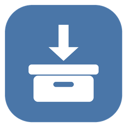

<h1 align="center">VK Archive Enrich</h1>

<b>Полный архив вашей страницы ВКонтакте: переписки с фото, видео и голосовыми, которые открываются без интернета.</b>

  <a href="https://github.com/optozorax/vk-archive-enrich/releases/latest"><b>⬇ Скачать для Windows</b></a> ·
  <a href="#как-пользоваться">Как пользоваться</a> ·
  <a href="#вопросы">Вопросы</a>

ВКонтакте по запросу выгружает архив данных вашей страницы — переписки, стену, друзей, фото. Но в нём **только текст**. Вместо фотографии написано
«Фотография», вместо пересланных сообщений — «3 прикреплённых сообщения», а аватарок, видео, голосовых и
записей со стены нет совсем. Если страница пропадёт или VK закроется, от десяти лет переписки останутся
голые строчки без контекста.

Эта программа берёт архив вашей страницы, докачивает из ВКонтакте всё недостающее и собирает **новую папку**, которая
открывается в любом браузере, выглядит почти как VK и работает без интернета. Исходный архив не меняется.

## Было и стало

<table>
<tr><th>Архив от VK</th><th>После программы</th></tr>
<tr>
<td>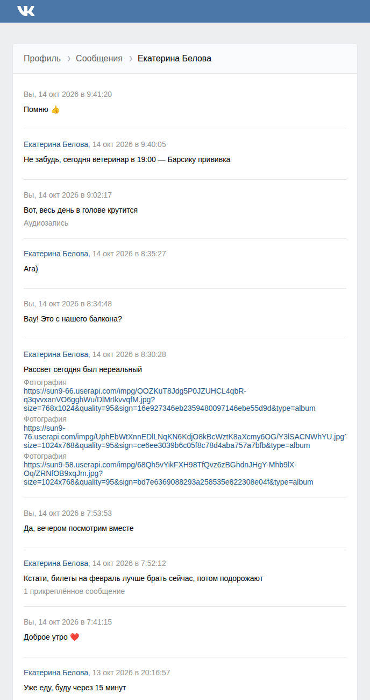</td>
<td>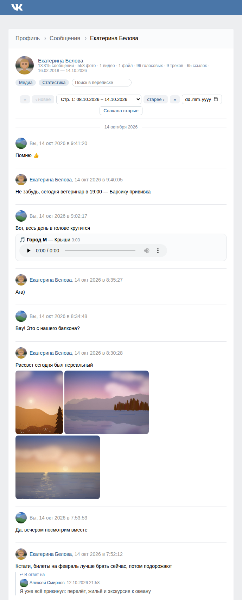</td>
</tr>
</table>

## Что вы получите

### Переписки как во ВКонтакте

Фотографии прямо в сообщениях (по клику — на весь экран), видео с плеером, голосовые с плеером и расшифровкой,
стикеры, ссылки с картинками, опросы с результатами, записи со стены, аватарки собеседников.
**Пересланные сообщения и ответы восстанавливаются целиком** — в архиве VK их нет вообще.

### Легко найти нужное

Список переписок можно сортировать: недавние, самые большие, где больше всего ваших сообщений или фото.
Внутри переписки — выбор страницы и **переход к любой дате через календарь**, разделители по дням,
режим «сначала старые». А ещё **поиск по тексту всех сообщений**, в том числе пересланных.

<table>
<tr>
<td>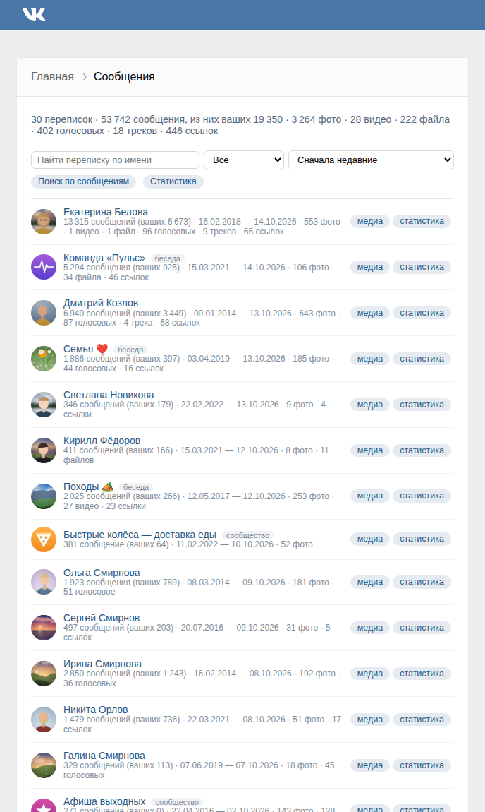</td>
<td>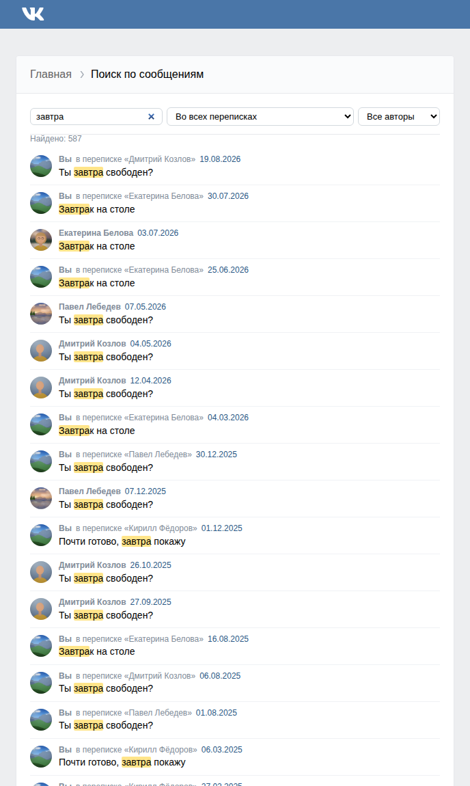</td>
</tr>
</table>

### Все фото и видео переписки на одной странице

Сетка всех фотографий, список видео, файлов, голосовых и ссылок — у каждого кнопка «к сообщению».

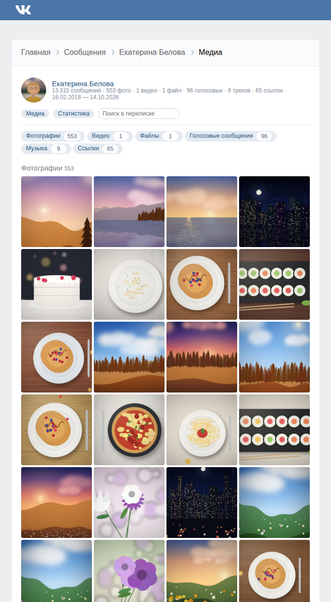

### Статистика

Календарь активности, как на GitHub, — по всем перепискам и по каждой отдельно. Сколько вы писали по годам,
в какие часы и дни недели, с кем переписываетесь больше всего, кто сколько писал в беседе. Отправленные и
полученные сообщения считаются отдельно, а рассылки сообществ можно не учитывать.

<table>
<tr>
<td>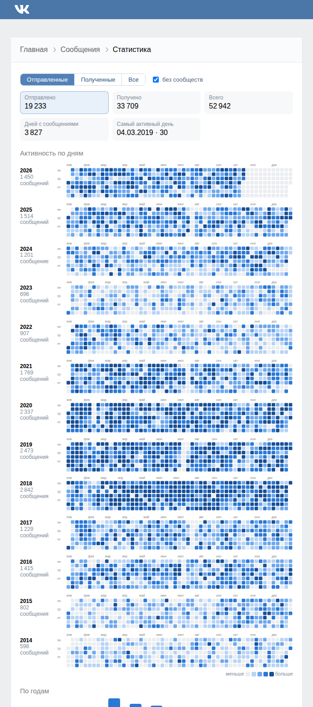</td>
<td>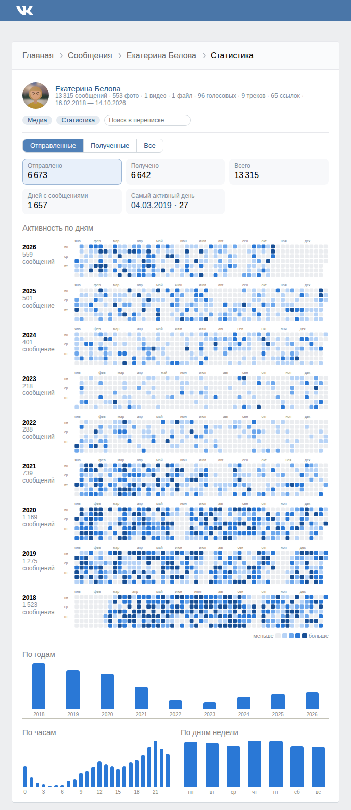</td>
</tr>
</table>

### И остальное

Друзья, заявки и подписки с аватарками (у каждого кнопка перехода в переписку), стена с фото, репостами и
комментариями, фотоальбомы, документы, подарки, ваша переписка с поддержкой ВКонтакте. По желанию — всё, что вы лайкали: фото с авторами, записи
целиком, тексты комментариев. На главной сразу видно, где сколько всего, а пустые разделы приглушены.

<table>
<tr><th>Главная в архиве VK</th><th>После программы</th></tr>
<tr>
<td>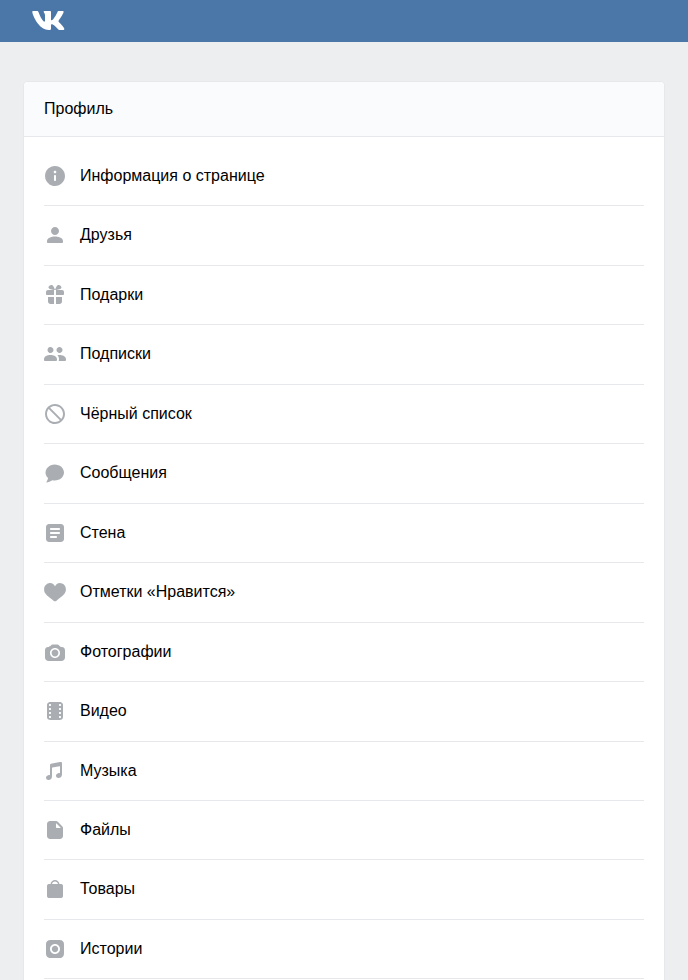</td>
<td>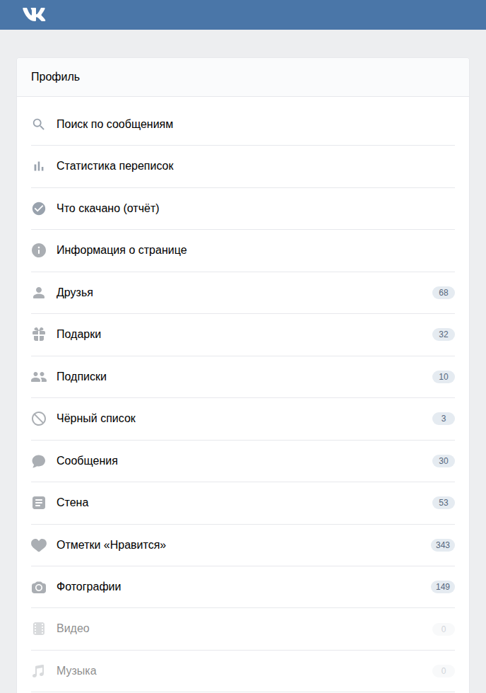</td>
</tr>
</table>

## Как пользоваться

1. **Запросите архив у ВКонтакте**: [vk.com/data_protection](https://vk.com/data_protection?section=rules&scroll_to_archive=1)
   → «Запросить архив» → отметьте всё. Ссылка придёт через несколько часов или дней. Скачайте zip и распакуйте.
2. **Скачайте программу**: [vk_archive_enrich-windows-x64.zip](https://github.com/optozorax/vk-archive-enrich/releases/latest),
   распакуйте и запустите `vk_archive_enrich.exe`. Устанавливать ничего не нужно: всё уже внутри.
3. **Войдите в vk.ru в браузере Firefox** — оттуда программа возьмёт вход. Логин и пароль она не спрашивает.
   Если у вас Chrome или Яндекс Браузер, смотрите [вопросы](#вопросы).
4. **Выберите папку архива** (ту, где лежит `index.html`), отметьте, что скачать, и нажмите «Начать».
5. Когда всё закончится, нажмите **«Открыть результат»**.

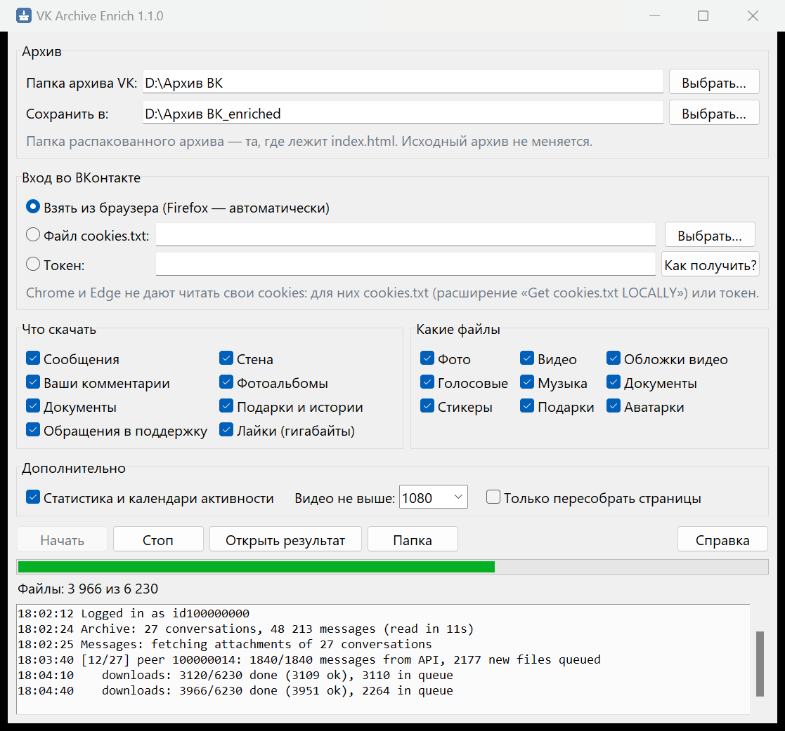

Скачивание может идти несколько часов: больше всего времени и места занимают видео. Его можно остановить и
запустить снова — программа продолжит с того же места и заодно попробует ещё раз скачать то, что не вышло.

На macOS и Linux программа запускается из исходников, подробности — в [документации для продвинутых](docs/ADVANCED.md).

## Чем она хороша

- **Получается настоящий архив, а не россыпь файлов по папкам.** Фото стоят в своих сообщениях, у каждого
  сообщения видно автора и дату, переписку можно читать подряд.
- **Восстанавливает то, чего в архиве VK нет совсем:** пересланные сообщения, ответы, записи со стены,
  стикеры, аватарки.
- **Скачивает и видео, и музыку**, а не только картинки.
- **Поиск, календарь и статистика** работают прямо в браузере, без интернета.
- **Можно прерывать.** Повторный запуск докачивает недостающее и ничего не скачивает дважды.
- **Можно выбрать**, что качать: только переписки, без видео, с лайками и так далее.
- **Окно, а не командная строка**, и ничего не надо устанавливать.

## Вопросы

**Это безопасно?** Программа не спрашивает логин и пароль: она берёт вход из вашего браузера, как это делает
сам сайт vk.ru, и обращается только к серверам ВКонтакте. Ничего никуда не отправляет и не меняет ваш
исходный архив. Код открыт.

**Windows пишет «Система Windows защитила ваш компьютер».** Так бывает с программами без платной цифровой
подписи. Нажмите «Подробнее», затем «Выполнить в любом случае».

**У меня Chrome, Edge или Яндекс Браузер.** Эти браузеры не дают другим программам читать свой вход. Проще
всего войти в vk.ru в Firefox. Можно и без него: в окне программы выберите «Токен» и нажмите «Как получить?» —
там пошаговая инструкция. Или выгрузите файл cookies.txt расширением «Get cookies.txt LOCALLY» (кнопка
Export All Cookies) и укажите его в окне; после работы удалите этот файл.

**Сколько места нужно?** Зависит от того, сколько у вас было фото и видео. Архив с сотнями тысяч сообщений
занимает десятки гигабайт, больше половины — видео. Если видео не нужны, снимите галочку «Видео».

**Почему что-то не скачалось?** Часть старых файлов ВКонтакте потерял сам: они не открываются и на сайте.
Ещё недоступны удалённые и закрытые видео, истёкшие истории, файлы заблокированных пользователей. Список
всего, что не удалось скачать, с причинами — на странице «Что скачано» в готовом архиве.

**Можно скачать фото, которые я лайкал?** Да, отметьте «Лайки». Это могут быть гигабайты чужих фотографий,
поэтому по умолчанию выключено.

**Что делать с готовой папкой?** Храните где угодно и открывайте `index.html`. Интернет не нужен. Не
выкладывайте папку в открытый доступ: там ваша личная переписка.

## Для продвинутых

Параметры командной строки, вход через cookies или токен, выбор разделов, сборка программы и обновление
этих скриншотов — в [docs/ADVANCED.md](docs/ADVANCED.md).

## Лицензия

MIT. Программа не связана с ВКонтакте; используйте её только для своего аккаунта.
