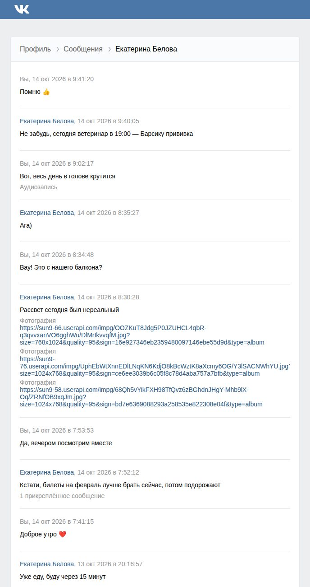
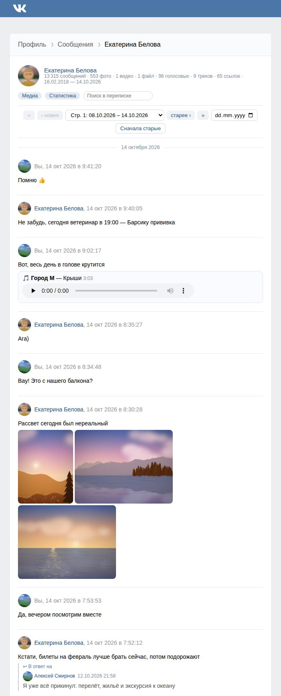
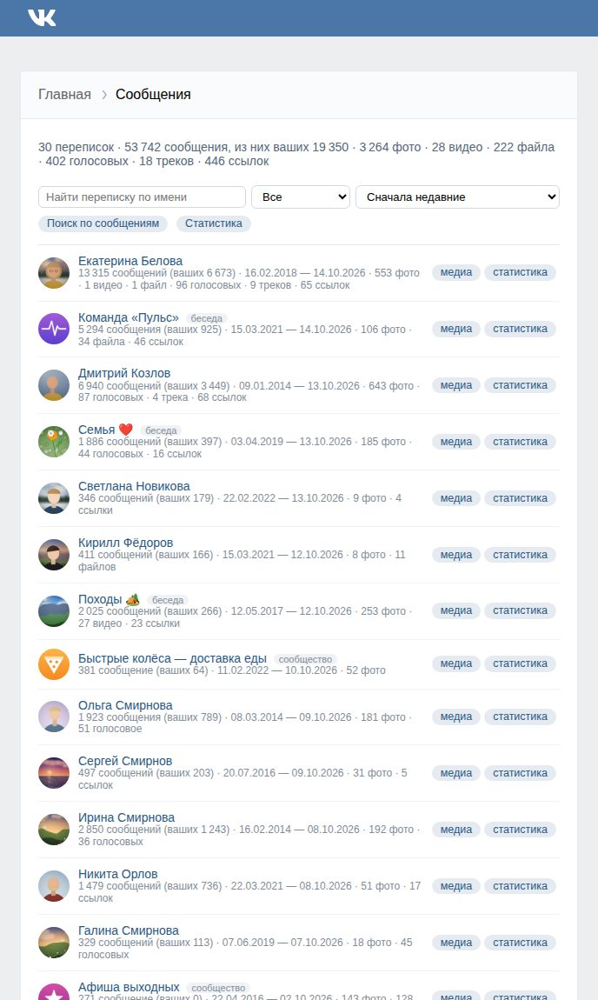
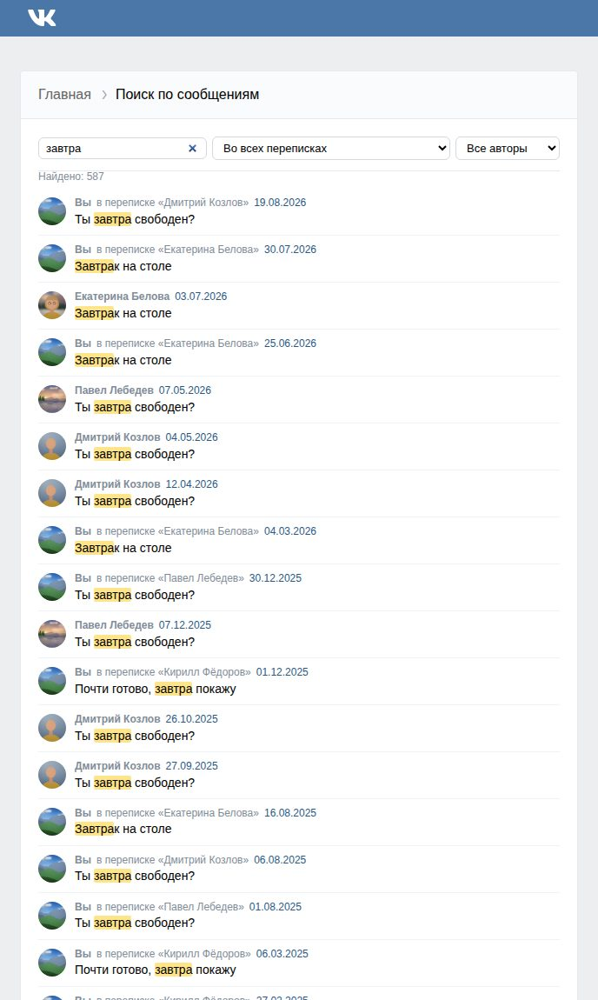
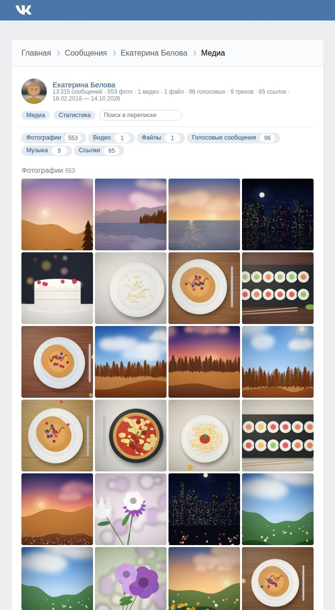
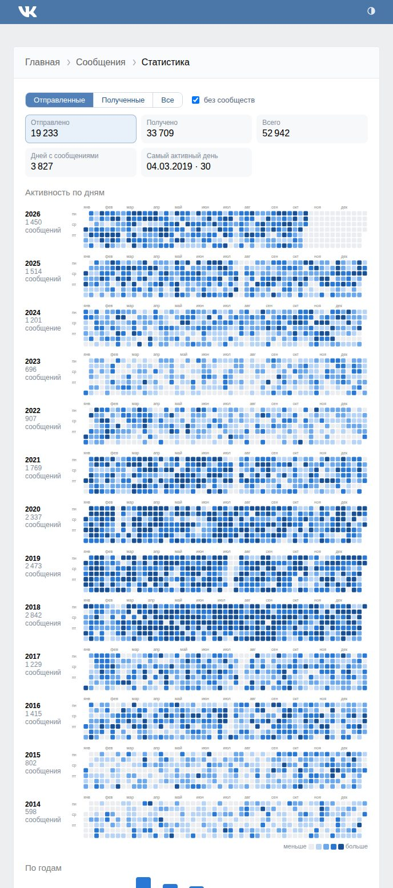
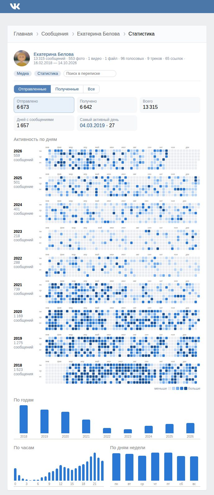
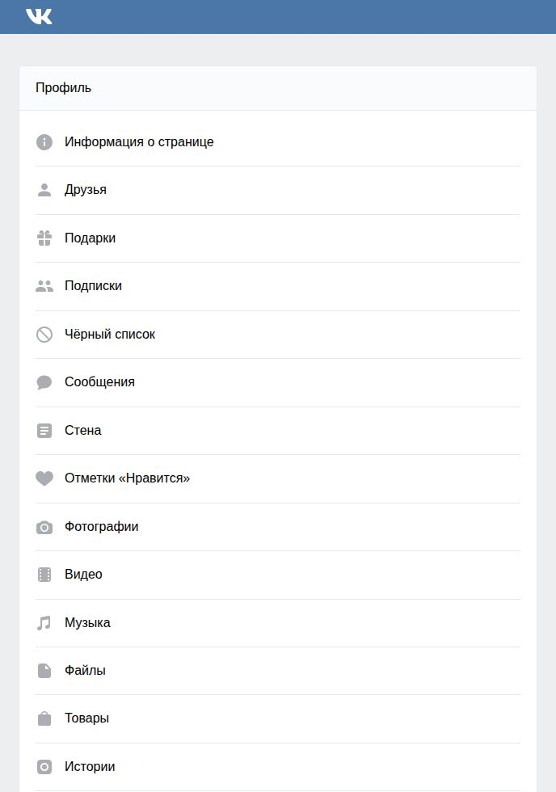
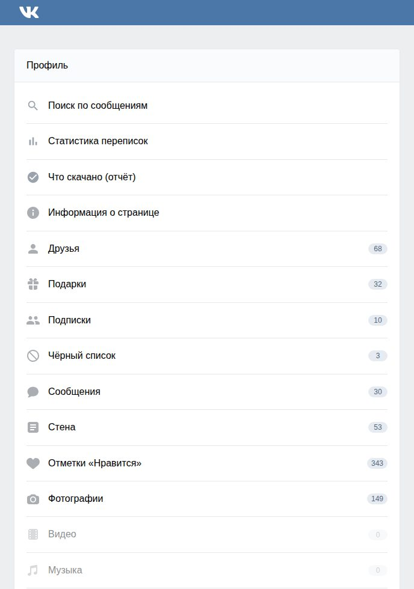
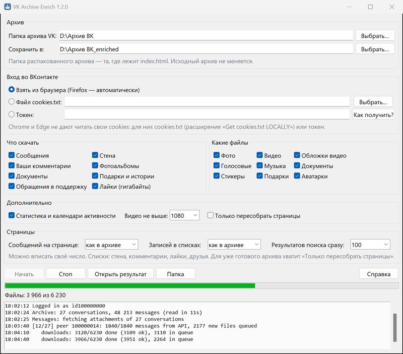

<p align="center"></p>

<h1 align="center">VK Archive Enrich</h1>

<p align="center"><b>Полный архив вашей страницы ВКонтакте: переписки с фото, видео и голосовыми, которые открываются без интернета.</b></p>

<p align="center">
  <a href="https://github.com/optozorax/vk-archive-enrich/releases/latest"><b>⬇ Скачать для Windows</b></a> ·
  <a href="#как-пользоваться">Как пользоваться</a> ·
  <a href="#вопросы">Вопросы</a>
</p>

ВКонтакте по запросу выгружает [архив данных вашей страницы](https://vk.com/data_protection?section=rules&scroll_to_archive=1) — переписки, стену, друзей, фото. Но в нём **только текст**. Вместо фотографии написано
«Фотография», вместо пересланных сообщений — «3 прикреплённых сообщения», а аватарок, видео, голосовых и
записей со стены нет совсем. Если страница пропадёт или VK закроется, от десяти лет переписки останутся
голые строчки без контекста.

Эта программа берёт архив вашей страницы, докачивает из ВКонтакте всё недостающее и собирает **новую папку**, которая
открывается в любом браузере, выглядит почти как VK и работает без интернета. Исходный архив не меняется.

## Было и стало

<table>
<tr><th>Архив от VK</th><th>После программы</th></tr>
<tr>
<td></td>
<td></td>
</tr>
</table>

## Что вы получите

### Переписки как во ВКонтакте

Фотографии прямо в сообщениях (по клику — на весь экран), видео с плеером, голосовые с плеером и расшифровкой,
стикеры, ссылки с картинками, опросы с результатами, записи со стены, аватарки собеседников.
**Пересланные сообщения и ответы восстанавливаются целиком** — в архиве VK их нет вообще.

### Легко найти нужное

Список переписок можно сортировать: недавние, самые большие, где больше всего ваших сообщений или фото.
Внутри переписки — выбор страницы и **переход к любой дате через календарь**, разделители по дням,
режим «сначала старые». А ещё **поиск по тексту всех сообщений**, в том числе пересланных.
Сколько сообщений будет на одной странице, решаете вы: 50, как в архиве, 500 или вся переписка целиком.

<table>
<tr>
<td></td>
<td></td>
</tr>
</table>

### Все фото и видео переписки на одной странице

Сетка всех фотографий, список видео, файлов, голосовых и ссылок — у каждого кнопка «к сообщению».



### Статистика

Календарь активности, как на GitHub, — по всем перепискам и по каждой отдельно. Сколько вы писали по годам,
в какие часы и дни недели, с кем переписываетесь больше всего, кто сколько писал в беседе. Отправленные и
полученные сообщения считаются отдельно, а рассылки сообществ можно не учитывать.

<table>
<tr>
<td></td>
<td></td>
</tr>
</table>

### И остальное

Друзья, заявки и подписки с аватарками (у каждого кнопка перехода в переписку), стена с фото, репостами и
комментариями, фотоальбомы, документы, подарки, ваша переписка с поддержкой ВКонтакте. По желанию — всё, что вы лайкали: фото с авторами, записи
целиком, тексты комментариев. На главной сразу видно, где сколько всего, а пустые разделы приглушены.

Есть **тёмная тема**: она включается сама, если тёмная тема стоит в Windows, а переключатель
в шапке страницы позволяет выбрать светлую или тёмную навсегда.

<table>
<tr><th>Главная в архиве VK</th><th>После программы</th></tr>
<tr>
<td></td>
<td></td>
</tr>
</table>

## Как пользоваться

1. **Запросите архив у ВКонтакте**: [vk.com/data_protection](https://vk.com/data_protection?section=rules&scroll_to_archive=1)
   → «Запросить архив» → отметьте всё. Ссылка придёт через несколько часов или дней. Скачайте zip и распакуйте.
2. **Скачайте программу**: [vk_archive_enrich-windows-x64.zip](https://github.com/optozorax/vk-archive-enrich/releases/latest),
   распакуйте и запустите `vk_archive_enrich.exe`. Устанавливать ничего не нужно: всё уже внутри.
3. **Войдите в vk.ru в браузере Firefox** — оттуда программа возьмёт вход. Логин и пароль она не спрашивает.
   Если у вас Chrome или Яндекс Браузер, смотрите [вопросы](#вопросы).
4. **Выберите папку архива** (ту, где лежит `index.html`), отметьте, что скачать, и нажмите «Начать».
5. Когда всё закончится, нажмите **«Открыть результат»**.

<p align="center"></p>

Скачивание может идти несколько часов: больше всего времени и места занимают видео. Его можно остановить и
запустить снова — программа продолжит с того же места и заодно попробует ещё раз скачать то, что не вышло.

На macOS и Linux программа запускается из исходников, подробности — в разделе [для продвинутых](#для-продвинутых).

## Чем она хороша

- **Получается настоящий архив, а не россыпь файлов по папкам.** Фото стоят в своих сообщениях, у каждого
  сообщения видно автора и дату, переписку можно читать подряд.
- **Восстанавливает то, чего в архиве VK нет совсем:** пересланные сообщения, ответы, записи со стены,
  стикеры, аватарки.
- **Скачивает и видео, и музыку**, а не только картинки.
- **Поиск, календарь и статистика** работают прямо в браузере, без интернета.
- **Можно прерывать.** Повторный запуск докачивает недостающее и ничего не скачивает дважды.
- **Можно выбрать**, что качать: только переписки, без видео, с лайками и так далее.
- **Окно, а не командная строка**, и ничего не надо устанавливать.

## Вопросы

**Это безопасно?** Программа не спрашивает логин и пароль: она берёт вход из вашего браузера, как это делает
сам сайт vk.ru, и обращается только к серверам ВКонтакте. Ничего никуда не отправляет и не меняет ваш
исходный архив. Код открыт.

**Windows пишет «Система Windows защитила ваш компьютер».** Так бывает с программами без платной цифровой
подписи. Нажмите «Подробнее», затем «Выполнить в любом случае».

**У меня Chrome, Edge или Яндекс Браузер.** Эти браузеры не дают другим программам читать свой вход. Проще
всего войти в vk.ru в Firefox. Можно и без него: в окне программы выберите «Токен» и нажмите «Как получить?» —
там пошаговая инструкция. Или выгрузите файл cookies.txt расширением [«Get cookies.txt LOCALLY»](https://chromewebstore.google.com/detail/get-cookiestxt-locally/cclelndahbckbenkjhflpdbgdldlbecc) (кнопка
Export All Cookies) и укажите его в окне; после работы удалите этот файл.

**Сколько места нужно?** Зависит от того, сколько у вас было фото и видео. Архив с сотнями тысяч сообщений
занимает десятки гигабайт, больше половины — видео. Если видео не нужны, снимите галочку «Видео».

**Почему что-то не скачалось?** Часть старых файлов ВКонтакте потерял сам: они не открываются и на сайте.
Ещё недоступны удалённые и закрытые видео, истёкшие истории, файлы заблокированных пользователей. Список
всего, что не удалось скачать, с причинами — на странице «Что скачано» в готовом архиве.

**При запросе архива я отметил не всё.** Ничего страшного: программа обработает те разделы, которые есть.

**В журнале появились строки ERROR.** Если какую-то часть обработать не удалось, программа пишет об этом,
пропускает её и доделывает остальное: страницы всё равно соберутся. Запустите ещё раз. Если ошибка
повторяется, [напишите нам](https://github.com/optozorax/vk-archive-enrich/issues) и приложите строки с ERROR.

**Можно больше сообщений на одной странице?** Да. В окне программы, в блоке «Страницы», выберите или
впишите число, например 500, или «все на одной». Так же настраиваются стена, комментарии, лайки и друзья
(«Записей в списках») и сколько результатов поиска показывать сразу. Если архив уже готов, отметьте
«Только пересобрать страницы» и нажмите «Начать»: это быстро и без интернета.

**Можно скачать фото, которые я лайкал?** Да, отметьте «Лайки». Это могут быть гигабайты чужих фотографий,
поэтому по умолчанию выключено.

**Что делать с готовой папкой?** Храните где угодно и открывайте `index.html`. Интернет не нужен. Не
выкладывайте папку в открытый доступ: там ваша личная переписка.

## Для продвинутых

Обычным пользователям этот раздел не нужен: хватит программы с окном. Здесь подробности для тех, кто
запускает из командной строки, хочет тонко настроить загрузку или собрать программу сам.

### Запуск из исходников (Windows, macOS, Linux)

Нужен Python 3.9+ и пакет `requests`; для музыки нужен ffmpeg в PATH, для чтения cookies Chrome-подобных
браузеров и для видео с YouTube нужен `yt-dlp`.

```
pip install -r requirements.txt
python3 vk_archive_enrich.py                    # без параметров откроется окно
python3 vk_archive_enrich.py "путь/к/архиву"    # или сразу командная строка
```

В сборке для Windows то же самое делает `vk_archive_enrich_cli.exe`.

### Вход во ВКонтакте

Скрипту нужен доступ к вашему аккаунту: тот же, что у сайта vk.ru, когда вы на нём залогинены. Логин и пароль
он не спрашивает. Он берёт cookies вашей сессии из браузера и получает у `login.vk.ru` временный токен ровно так,
как это делает сам vk.ru. Токен хранится только в памяти и никуда не записывается. Запросы идут только к серверам
VK. Код открыт, его можно прочитать.

| Как | Команда | Когда подходит |
|---|---|---|
| **Firefox** | ничего не нужно, найдётся сам | проще всего; работает на Windows, Linux, macOS, в WSL |
| Firefox, другой профиль | `--browser firefox:"путь/к/профилю"` | несколько профилей |
| Chrome, Edge, Brave, Opera, Vivaldi, Chromium, Safari | `--browser chrome` | нужен `pip install yt-dlp`. **На Windows с Chrome/Edge не сработает**, см. ниже |
| **Файл cookies.txt** | `--cookies cookies.txt` | любой браузер, включая Chrome и Яндекс Браузер |
| **Токен вручную** | `--token ask` | любой браузер, без расширений |

**Почему Chrome на Windows не подходит напрямую.** С середины 2024 года Chrome и Edge шифруют cookies так
(app-bound encryption), что их не может прочитать ни одна внешняя программа. Варианты:

- **cookies.txt.** Поставьте расширение [Get cookies.txt LOCALLY](https://chromewebstore.google.com/detail/get-cookiestxt-locally/cclelndahbckbenkjhflpdbgdldlbecc),
  откройте vk.ru и нажмите **Export All Cookies**. Нужны все cookies: VK держит часть сессии на `login.vk.ru`.
  Запустите с `--cookies путь/к/cookies.txt`. Скрипт возьмёт из файла только cookies VK. **После работы удалите файл**:
  в нём ваши сессии.
- **Токен.** Запустите с `--token ask`, и скрипт покажет строчку для консоли браузера (vk.ru → F12 → Console). Она
  выводит токен, вы вставляете его в скрытое поле ввода. Токен живёт около часа. Если загрузка длиннее, скрипт
  попросит новый, и та же строчка выдаст его снова.

### Что скачивать

По умолчанию скачивается всё, кроме лайков. Это можно настроить:

| Раздел (`--only` / `--skip`) | Что это |
|---|---|
| `messages` | вложения сообщений, пересланные сообщения |
| `wall` | вложения записей на стене и комментариев к ним |
| `comments` | вложения ваших комментариев |
| `albums` | ваши фотоальбомы |
| `docs` | ваши документы |
| `profile` | подарки, истории |
| `support` | переписка с поддержкой VK по вашим обращениям (только при входе через браузер или cookies.txt, не через токен) |
| `likes` | то, что вы лайкали; включается флагом `--likes`, это гигабайты чужих фото |

| Тип файлов (`--no-media`) | |
|---|---|
| `photos` | фотографии и картинки |
| `videos` | видеофайлы (обложки видео качаются отдельно, тип `covers`) |
| `covers` | обложки видео |
| `voice` | голосовые сообщения |
| `music` | аудиозаписи |
| `docs` | документы |
| `stickers`, `gifts`, `avatars` | стикеры, подарки, аватарки |

Примеры:
```
# только переписки, без видео и музыки
python3 vk_archive_enrich.py Archive --only messages --no-media videos,music

# всё, плюс лайки и статистика
python3 vk_archive_enrich.py Archive --likes --github-activity

# всё, кроме стены; видео не больше 720p и 500 МБ
python3 vk_archive_enrich.py Archive --skip wall --max-video-height 720 --max-video-mb 500

# пересобрать страницы без интернета (например, после обновления скрипта)
python3 vk_archive_enrich.py Archive --offline --github-activity

# то же, но по 500 сообщений на странице, а стена, лайки и комментарии по 100
python3 vk_archive_enrich.py Archive --offline --github-activity --messages-per-page 500 --items-per-page 100
```

### Все параметры

| Параметр | Что делает |
|---|---|
| `SRC` | папка с распакованным архивом (там лежит `index.html`) |
| `DST` | куда писать результат, по умолчанию рядом: `<архив>_enriched` |
| `--browser NAME[:PROFILE]` | браузер для входа: `firefox`, `chrome`, `edge`, `brave`, `opera`, `vivaldi`, `chromium`, `whale`, `safari` |
| `--cookies FILE` | cookies.txt в формате Netscape |
| `--token TOKEN` / `--token ask` | готовый токен / спросить токен |
| `--only`, `--skip` | разделы через запятую (см. таблицу выше) |
| `--likes` | добавить раздел лайков |
| `--no-media TYPES` | не качать эти типы файлов |
| `--external-videos` | качать и встроенные в VK видео с YouTube и т.п. (через yt-dlp) |
| `--max-video-height N` | максимальное качество видео, по умолчанию 1080 |
| `--max-file-mb N`, `--max-video-mb N` | не качать файлы и видео больше N МБ |
| `--all-messages` | запрашивать из API все сообщения, а не только с вложениями (дольше, но в `_data` будут реакции, отметки о правках и т.д.) |
| `--github-activity` | календари активности и страницы статистики |
| `--offline` | без интернета, только пересобрать страницы |
| `--messages-per-page N` | сообщений на странице переписки; по умолчанию как в архиве (50), `0` — вся переписка на одной странице |
| `--items-per-page N` | записей на странице в списках: стена, комментарии, лайки, друзья, документы; по умолчанию как в архиве (лайки по 50), `0` — весь список на одной странице |
| `--search-results N` | сколько найденных сообщений поиск показывает сразу, до кнопки «Показать ещё»; по умолчанию 100, `0` — все |
| `--peers ID,ID` | скачивать только эти переписки (для пробы) |
| `--workers N`, `--video-workers N`, `--segments N` | параллельность загрузок: 8, 4 и 6 по умолчанию |

### Что внутри результата

```
Archive_enriched/
  index.html …                 те же страницы, что в архиве (в UTF-8), но дополненные
  messages/index-messages.html список переписок с сортировкой
  messages/<id>/media.html     медиа переписки
  messages/<id>/stats.html     статистика (с --github-activity)
  search.html                  поиск по сообщениям
  enrich-report.html           что скачано
  enrich.css, enrich.js        стили и скрипты страниц
  media/                       photos, videos, video_thumbs, docs, voice, audio, stickers, gifts, avatars, misc, archive
  search/                      тексты для поиска
  _data/                       ответы VK API в JSON, их можно использовать и для своих скриптов
```

### Частые проблемы

- **«VK asked for a captcha».** Слишком много запросов. Откройте vk.ru в браузере, походите по сайту, подождите несколько минут и запустите снова. Всё скачанное сохранится.
- **«No logged-in vk.ru session found».** Проверьте, что в этом браузере вы залогинены на vk.ru, и укажите браузер явно через `--browser`. Для Chrome и Edge на Windows используйте `--cookies` или `--token ask`.
- **«The browser is logged in as idX but the archive belongs to idY».** Скрипт защищает от путаницы: войдите в браузере в тот же аккаунт, чей архив.
- **Музыка не качается.** Нужен ffmpeg в PATH.
- **Страницы открываются, но без поиска и календаря.** Нужен JavaScript. Если открываете через просмотрщик, который его отключает, откройте `index.html` в обычном браузере.
- **WSL.** Работает: Firefox с Windows находится автоматически (`/mnt/c/Users/.../Firefox/Profiles`). Chrome из WSL расшифровать нельзя.

### Как это работает

1. Читает архив и для каждого сообщения получает id, дату, автора и текст.
2. Получает токен веб-версии VK (`login.vk.ru/?act=web_token`, приложение 6287487) по cookies браузера и обновляет его, когда он истекает.
3. Через `execute` пачками по 1000 вызывает `messages.getById` для сообщений с вложениями. Ответы сохраняются в `_data/`.
4. Качает файлы в несколько потоков с докачкой. Видео и музыка идут отдельной очередью и, если сервер разрешает, в несколько соединений на файл.
5. Собирает страницы: заменяет заглушки вложений на настоящие, добавляет аватарки, навигацию, счётчики, поиск и статистику.

Ограничение API: не больше 3 запросов в секунду, скрипт держится в нём сам.

### Сборка exe

Сборку для Windows делает GitHub Actions (`.github/workflows/build.yml`) при пуше тега `v*`: PyInstaller
собирает папку с двумя программами (окно и командная строка) и кладёт рядом ffmpeg (LGPL-сборка
[BtbN/FFmpeg-Builds](https://github.com/BtbN/FFmpeg-Builds)). Сборка проверяется на маленьком
ненастоящем архиве (`tests/smoke_test.py`), в том числе полным запуском через окно, и выкладывается в Releases.
Локально: положите `ffmpeg.exe` в `packaging/bin/` и выполните
`pip install pyinstaller requests yt-dlp && pyinstaller packaging/vk_archive_enrich.spec`.

### Скриншоты для README

Скриншоты делаются на выдуманном архиве: `tools/make_demo_archive.py` создаёт ненастоящий экспорт VK
и ненастоящие «уже скачанные» данные, программа собирает из них страницы без интернета, а
`tools/screenshots.py` фотографирует важные страницы в headless Chromium. Стиль `style.css` принадлежит
VK и в репозитории не лежит, его нужно взять из своего архива:

```
pip install playwright pillow
python -m playwright install chromium
python tools/screenshots.py --style "путь/к/Archive/style.css"
```

На Linux скрипт сам скачает цветной шрифт для эмодзи (Noto Color Emoji) и подключит его только для этого
браузера. Если Chromium уже установлен, укажите его через `--chromium путь`.

Окно программы снимается на Windows отдельно: `py tools\screenshot_window.py`. Скрипт открывает окно с
примером заполнения и фотографирует только его.

## Лицензия

MIT. Программа не связана с ВКонтакте; используйте её только для своего аккаунта.
